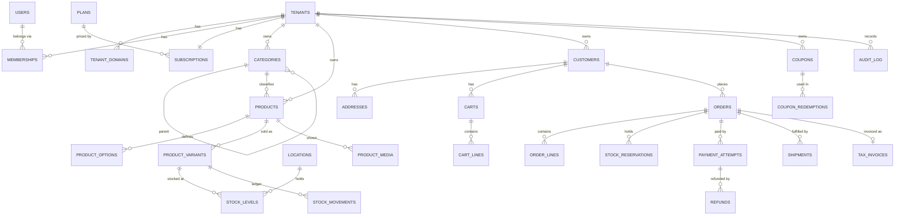

# Database Design

PostgreSQL 16+. snake_case names. Every primary key is a `uuid` (UUIDv7 generated in the application for
index locality). Money is `numeric(14,2)` in INR; the gateway receives integer paise. All timestamps are
`timestamptz`, in UTC.

**Conventions for tenant-owned tables:** `tenant_id uuid not null`; a unique `(tenant_id, id)` index used
by composite foreign keys; RLS enabled and forced; `created_at`, `updated_at`; `xmin` used as the
concurrency token.

## 1. ER overview

## 2. Entities

### Platform and identity

| Table | Key columns | Notes |
|---|---|---|
| `tenants` | id, slug (unique), name, status (`trialing, active, past_due, suspended, cancelled, deleted`), legal_name, gstin, state_code, settings jsonb, branding jsonb | **Not RLS-scoped**; readable through a platform-role view, and via `tenant_domains` lookup for storefront resolution |
| `tenant_domains` | host (unique), tenant_id, kind (`subdomain, custom`), verified_at | Storefront resolution |
| `users` | id, email (unique, citext), password_hash, name, email_verified_at, failed_logins, locked_until, is_platform_admin | Global; one user may belong to many tenants |
| `memberships` | tenant_id, user_id, role (`owner, manager, staff`), status (`invited, active, disabled`) | Unique (tenant_id, user_id). RLS-scoped |
| `invitations` | tenant_id, email, role, token_hash, expires_at | Token stored hashed |
| `customers` | tenant_id, email (citext), password_hash null, name, phone, marketing_opt_in | Unique (tenant_id, email). A null hash means a guest |
| `addresses` | tenant_id, customer_id, name, line1, line2, city, state_code, pincode, phone, is_default | |
| `plans` | code (PK), name, monthly_price (excl. GST), max_products/max_staff/max_locations (null = unlimited), custom_domain, is_public, sort_order, razorpay_plan_id (unique) | Platform-level; app role SELECT only |
| `subscriptions` | tenant_id, plan_code, gateway (`razorpay`, `test`, `manual`), gateway_subscription_id (unique), status, start_at, current_period_start/end, cancel_at_period_end, pending_plan_code | Several per tenant over time; the store's state is derived from the open ones |
| `billing_invoices` | tenant_id, subscription_id, gateway_payment_id (unique), gateway_invoice_id, plan_code, amount, period_start/end, paid_at, invoice_url | Receipts of ShopMint's own charges |

### Catalogue and inventory

| Table | Key columns | Notes |
|---|---|---|
| `categories` | tenant_id, parent_id null, name, slug, position | Unique (tenant_id, slug) |
| `products` | tenant_id, category_id, title, slug, description, status (`draft, active, archived`), hsn_code, gst_rate (0/5/12/18/28), tags text[], search tsvector | Unique (tenant_id, slug); GIN index on search |
| `product_options` | tenant_id, product_id, name (for example Size), values text[], position | Maximum 3 per product |
| `product_variants` | tenant_id, product_id, sku, option_values text[], price, mrp, cost, weight_grams, is_active | Unique (tenant_id, sku); `CHECK (price > 0 AND mrp >= price)` |
| `product_media` | tenant_id, product_id, storage_key, alt, position, width, height | |
| `locations` | tenant_id, name, code, address, state_code, is_default | Warehouses |
| `stock_levels` | tenant_id, variant_id, location_id, on_hand, reserved | PK (variant_id, location_id); `CHECK (reserved >= 0 AND reserved <= on_hand)` |
| `stock_movements` | tenant_id, variant_id, location_id, delta, reason (`adjustment, sale, return, receipt, correction`), ref_type, ref_id, actor_id | Append-only ledger |
| `stock_reservations` | tenant_id, order_id, variant_id, location_id, qty, expires_at, status | |

### Commerce

| Table | Key columns | Notes |
|---|---|---|
| `carts` | tenant_id, token_hash, customer_id null, coupon_code, expires_at | An anonymous cart is identified by a cookie token |
| `cart_lines` | tenant_id, cart_id, variant_id, qty | Prices are **not** stored; they are recomputed |
| `orders` | tenant_id, number (per-tenant sequence), customer_id, email, status, payment_status, currency, subtotal, discount_total, shipping_total, cod_fee, tax_total, grand_total, shipping_address jsonb, billing_address jsonb, place_of_supply_state, coupon_code, placed_at | Unique (tenant_id, number) |
| `order_lines` | tenant_id, order_id, variant_id, title, variant_title, sku, hsn, gst_rate, unit_price, unit_cost, qty, discount_alloc, taxable_value, cgst, sgst, igst, line_total | **Snapshot**: immutable after placement |
| `order_events` | tenant_id, order_id, from_status, to_status, note, actor | Timeline |
| `payment_attempts` | tenant_id, order_id, provider, provider_order_id (unique), provider_payment_id, amount, status, raw jsonb | |
| `refunds` | tenant_id, payment_attempt_id, amount, reason, status, provider_refund_id | |
| `shipments` | tenant_id, order_id, carrier, awb, status, shipped_at, delivered_at | |
| `tax_invoices` | tenant_id, order_id, series, number, issued_at, totals jsonb | Unique (tenant_id, series, number); immutable; credit notes for returns |
| `coupons` | tenant_id, code (citext), kind (`percent, flat`), value, max_discount, min_subtotal, starts_at, ends_at, usage_limit, per_customer_limit, times_used, is_active | Unique (tenant_id, code). `times_used` is incremented with a conditional update |
| `coupon_redemptions` | tenant_id, coupon_id, order_id, customer_id | |

### Infrastructure

| Table | Notes |
|---|---|
| `audit_log` | tenant_id null (platform events), actor_user_id, action, entity_type, entity_id, changes jsonb, ip, correlation_id, at. Append-only: the app role has INSERT and SELECT only |
| `outbox_messages` | id, tenant_id, type, payload jsonb, occurred_at, processed_at, attempts, last_error |
| `inbox_messages` | provider, event_id (unique), received_at, processed_at: webhook de-duplication |
| `idempotency_keys` | tenant_id, key, route, request_hash, response jsonb, status_code, created_at (TTL 24h) |

## 3. Indexing (initial; revisit with `pg_stat_statements`)

- `products (tenant_id, status, created_at desc)`, `products USING gin(search)`
- `orders (tenant_id, placed_at desc)`, `orders (tenant_id, status)`, `orders (tenant_id, customer_id)`
- `stock_levels (tenant_id, variant_id)`, `stock_reservations (expires_at) WHERE status='active'`
- `outbox_messages (occurred_at) WHERE processed_at IS NULL`

## 4. Roles

| Role | Privileges |
|---|---|
| `shopmint_owner` | Owns the schema; runs migrations. In AWS, `deploy-db` creates all three roles as the RDS master user and sets their passwords from Secrets Manager |
| `shopmint_app` | DML on tenant tables (RLS enforced), INSERT/SELECT on `audit_log`, SELECT on `tenant_domains`, `plans` |
| `shopmint_platform` | `BYPASSRLS`; used only by the platform console and system jobs that span tenants. Sole reader/writer of `data_protection_keys` |

## 5. Implemented so far

See `apps/api/src/ShopMint.Api/Infrastructure/Persistence/Migrations`. Phase 4 delivers `tenants`,
`tenant_domains`, `users`, `memberships`, `categories`, `products`, `product_variants` and `audit_log`,
with RLS on every tenant-owned table.

Phase 5 (`Phase5Identity` migration) adds:
- `users.email_verified_at` and `tenants.launched_at`.
- `user_tokens` (global, like `users`): password-reset and email-verification tokens, stored as SHA-256 hashes (unique), with `expires_at` and `used_at`.
- `invitations` (tenant-owned, standard RLS): email, role, token hash (unique), inviter, `expires_at`, `accepted_at`, `revoked_at`, `last_sent_at`.
Phase 6 (`Phase6Catalog`, `Phase6StorageDeletions` migrations) adds:
- `product_media` (tenant-owned, standard RLS, composite FK to the product, cascade delete): storage key (unique), content
  type, size, alt text, position, status `Pending`/`Ready`.
- `stock_movements.note` and `batch_id` (groups transfer pairs and multi-line adjustments), plus reasons `Damaged`, `Lost`,
  `TransferOut`, `TransferIn`.
- `categories.xmin` as a concurrency token (ETag / If-Match).
- `storage_deletions`: files to delete after a delay; the app role may only `INSERT`.

Phase 7 (`Phase7Customers` migration) adds five tenant-owned tables with standard RLS and composite foreign keys:
- `customers` (unique `(tenant_id, normalized_email)`), `customer_tokens` (hashed reset tokens), `customer_addresses`.
- `carts` (one per customer via a partial unique index; guest carts by unique `token_hash`) and `cart_lines`
  (unique per cart and variant, `quantity > 0`, cascade-deleted with the variant).

Phase 8 (`Phase8Orders` migration) adds nine tenant-owned tables with standard RLS. The design above was simplified
where the first release doesn't need a separate table (events live in the audit log, the invoice is columns on the
order, idempotency is a unique key on the order, coupon usage is counted per customer from orders):
- `orders`: per-store `number` (unique), customer, email, status, payment method and status, address snapshot, seller
  snapshot (name, legal name, GSTIN, address, state), money columns (`numeric(14,2)`), coupon code, `reserved_until`,
  `idempotency_key` (unique per customer when set), invoice number (unique when set) and date, `xmin` concurrency token.
- `order_lines`: immutable snapshot of title, variant, SKU, HSN, GST rate, prices, discount allocation and tax split.
  `variant_id` has no foreign key (orders outlive catalogue changes); ordered variants can't be deleted.
- `payment_attempts` (unique `(gateway, gateway_order_id)`), `refunds` (unique gateway refund ID), `shipments`.
- `coupons` (unique code per store; `times_used` claimed with a conditional update).
- `tenant_counters`: per-store sequences (order numbers, invoice series per financial year), incremented with
  `INSERT … ON CONFLICT DO UPDATE … RETURNING`.
- `tenant_payment_settings`: Razorpay key ID plus the key secret and webhook secret encrypted with AES-256-GCM.
- `webhook_events`: primary key `(gateway, event_id)`, the webhook inbox.
- `tenants` gains `business_address`, `shipping_fee`, `free_shipping_threshold`, `cod_enabled`, `cod_max_order_value`.

Phase 9 (`Phase9Billing` migration) adds `plans` (seeded with the four plans; the app role may only read it),
`subscriptions` and `billing_invoices` (standard RLS), and on `tenants`: `suspension_reason` (`Platform`,
`TrialExpired`, `PaymentFailed`), `grace_ends_at` and `trial_reminder_sent_at`. `tenants.status` and `plan_code` are now
derived from subscriptions by the billing service. Existing paid stores get a `manual` subscription for their plan.

Phase 10 (`Phase10Notifications` migration) adds `memberships.notify_new_orders` / `notify_low_stock` (null = role
default), `tenants.abandoned_cart_emails`, `low_stock_digest_at` and `low_stock_digest_hash`, `carts.reminder_sent_at`,
and `customer_tokens.purpose` (`PasswordReset`, `Unsubscribe`; existing rows are reset tokens). Reports read existing
order tables; no reporting tables or materialised views yet.

- `email_outbox`: RLS allows only `INSERT` by the app role, for its own tenant or with no tenant; the app role has no `SELECT`/`UPDATE`/`DELETE` grant. The dispatcher uses the platform role.

Phase 11 (`Phase11Security` migration) adds:
- `users.totp_secret_enc` and `totp_pending_secret_enc` (AES-256-GCM with the platform secrets key), `totp_enabled_at`,
  `totp_last_step` (replay protection) and `recovery_code_hashes` (`text[]`, SHA-256, default empty).
- `user_tokens.purpose` gains `MfaChallenge` (5-minute, single-use sign-in challenge between password and code).
- `data_protection_keys` (id, friendly_name, xml): ASP.NET Core's key ring for session cookies. The app role has no
  grant on it; only the platform role reads and writes it.

Phase 13 (`Phase13Feedback` migration) adds `feedback` (tenant-owned): user, category, message, page, may_contact,
status, team_note, timestamps; indexes on status/created_at, tenant and user. RLS: the app role may only `INSERT` rows
for its own tenant (no `SELECT`/`UPDATE`/`DELETE`); the platform role triages. Platform metrics read existing tables.

Phase 15 (`Phase15ReviewsWishlist` migration) adds two tenant-owned tables with the standard forced RLS policy:
`product_reviews` (product, customer, rating 1–5 with a check constraint, title, body, status Pending/Published/Hidden,
reply, replied_at, timestamps; unique (tenant, product, customer); indexes on product/status and tenant/status/updated_at)
and `wishlist_items` (key customer + product, tenant, created_at). Ratings are aggregated from published reviews when
read, so product rows (and their optimistic-concurrency version) don't change when a review is moderated.

Phase 16 (`Phase16StoreContent` migration) adds three tenant-owned tables with forced RLS: `storefront_settings` (one row
per store, keyed by tenant: hero heading/text, hero_media_id → product_media ON DELETE SET NULL, announcement, section
switches, featured_collection_id → collections ON DELETE SET NULL), `store_pages` (slug unique per store, title, body up
to 20,000 characters, published, position) and `collections` (slug unique per store, title, description, tag,
published, position). Option filters and facets use `generate_subscripts` over `products.option_names` joined to
active `product_variants.option_values`, with the tenant written into the query as well as enforced by RLS.

Phase 17 (`Phase17ReturnsDelivery` migration) adds `tenants.return_window_days`, `deliver_only_to_zones`,
`delivery_min_days`, `delivery_max_days`, and three tenant-owned tables with forced RLS: `shipping_zones` (name,
pincode_prefixes text[], fee and free threshold nullable = store default, min/max days, cod_available),
`return_requests` (order, customer, reason, resolution, note, status, store_note, restocked, refund_id → refunds
ON DELETE SET NULL, xmin concurrency) and `return_lines` (order line, quantity > 0). Return requests lock the order
row so two at once can't return the same units; receiving locks the stock levels it restocks.

Phase 18 (`Phase18GiftCardsNewsletter` migration) adds `orders.gift_card_id` (→ gift_cards, restrict),
`gift_card_amount`, `gift_card_restored`, and three tenant-owned tables with forced RLS: `gift_cards` (code_hash unique
per store, last4, initial_value, balance with a check `0 ≤ balance ≤ initial_value`, expires_at, is_active, recipient,
note, xmin), `gift_card_transactions` (card, order, kind Issued/Redeemed/Restored/Disabled, signed amount, balance
after) and `newsletter_subscribers` (email unique per store, status Pending/Subscribed/Unsubscribed, token hash,
confirmed/unsubscribed timestamps). The card row is locked (`FOR UPDATE`) whenever its balance changes.

