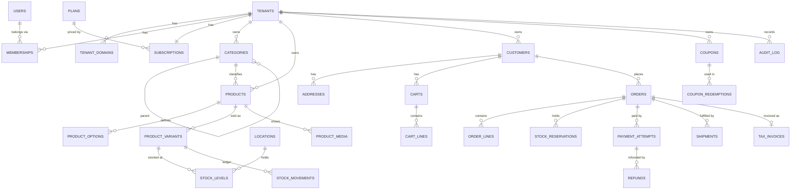

# Database Design

PostgreSQL 16+. snake_case names. Every primary key is a `uuid` (UUIDv7 generated in the application for
index locality). Money is `numeric(14,2)` in INR; the gateway receives integer paise. All timestamps are
`timestamptz`, in UTC.

**Conventions for tenant-owned tables:** `tenant_id uuid not null`; a unique `(tenant_id, id)` index used
by composite foreign keys; RLS enabled and forced; `created_at`, `updated_at`; `xmin` used as the
concurrency token.

## 1. ER overview

## 2. Entities

### Platform and identity

| Table | Key columns | Notes |
|---|---|---|
| `tenants` | id, slug (unique), name, status (`trialing, active, past_due, suspended, cancelled, deleted`), legal_name, gstin, state_code, settings jsonb, branding jsonb | **Not RLS-scoped**; readable through a platform-role view, and via `tenant_domains` lookup for storefront resolution |
| `tenant_domains` | host (unique), tenant_id, kind (`subdomain, custom`), verified_at | Storefront resolution |
| `users` | id, email (unique, citext), password_hash, name, email_verified_at, failed_logins, locked_until, is_platform_admin | Global; one user may belong to many tenants |
| `memberships` | tenant_id, user_id, role (`owner, manager, staff`), status (`invited, active, disabled`) | Unique (tenant_id, user_id). RLS-scoped |
| `invitations` | tenant_id, email, role, token_hash, expires_at | Token stored hashed |
| `customers` | tenant_id, email (citext), password_hash null, name, phone, marketing_opt_in | Unique (tenant_id, email). A null hash means a guest |
| `addresses` | tenant_id, customer_id, name, line1, line2, city, state_code, pincode, phone, is_default | |
| `plans` | id, code, name, price_monthly, price_yearly, entitlements jsonb, is_public | Platform-level |
| `subscriptions` | tenant_id, plan_id, status, trial_ends_at, current_period_end, gateway_subscription_id, grace_until | One per tenant |
| `billing_invoices` | tenant_id, subscription_id, amount, status, gateway_invoice_id, period_start/end | SaaS billing (ShopMint's revenue) |

### Catalogue and inventory

| Table | Key columns | Notes |
|---|---|---|
| `categories` | tenant_id, parent_id null, name, slug, position | Unique (tenant_id, slug) |
| `products` | tenant_id, category_id, title, slug, description, status (`draft, active, archived`), hsn_code, gst_rate (0/5/12/18/28), tags text[], search tsvector | Unique (tenant_id, slug); GIN index on search |
| `product_options` | tenant_id, product_id, name (for example Size), values text[], position | Maximum 3 per product |
| `product_variants` | tenant_id, product_id, sku, option_values text[], price, mrp, cost, weight_grams, is_active | Unique (tenant_id, sku); `CHECK (price > 0 AND mrp >= price)` |
| `product_media` | tenant_id, product_id, storage_key, alt, position, width, height | |
| `locations` | tenant_id, name, code, address, state_code, is_default | Warehouses |
| `stock_levels` | tenant_id, variant_id, location_id, on_hand, reserved | PK (variant_id, location_id); `CHECK (reserved >= 0 AND reserved <= on_hand)` |
| `stock_movements` | tenant_id, variant_id, location_id, delta, reason (`adjustment, sale, return, receipt, correction`), ref_type, ref_id, actor_id | Append-only ledger |
| `stock_reservations` | tenant_id, order_id, variant_id, location_id, qty, expires_at, status | |

### Commerce

| Table | Key columns | Notes |
|---|---|---|
| `carts` | tenant_id, token_hash, customer_id null, coupon_code, expires_at | An anonymous cart is identified by a cookie token |
| `cart_lines` | tenant_id, cart_id, variant_id, qty | Prices are **not** stored; they are recomputed |
| `orders` | tenant_id, number (per-tenant sequence), customer_id, email, status, payment_status, currency, subtotal, discount_total, shipping_total, cod_fee, tax_total, grand_total, shipping_address jsonb, billing_address jsonb, place_of_supply_state, coupon_code, placed_at | Unique (tenant_id, number) |
| `order_lines` | tenant_id, order_id, variant_id, title, variant_title, sku, hsn, gst_rate, unit_price, unit_cost, qty, discount_alloc, taxable_value, cgst, sgst, igst, line_total | **Snapshot**: immutable after placement |
| `order_events` | tenant_id, order_id, from_status, to_status, note, actor | Timeline |
| `payment_attempts` | tenant_id, order_id, provider, provider_order_id (unique), provider_payment_id, amount, status, raw jsonb | |
| `refunds` | tenant_id, payment_attempt_id, amount, reason, status, provider_refund_id | |
| `shipments` | tenant_id, order_id, carrier, awb, status, shipped_at, delivered_at | |
| `tax_invoices` | tenant_id, order_id, series, number, issued_at, totals jsonb | Unique (tenant_id, series, number); immutable; credit notes for returns |
| `coupons` | tenant_id, code (citext), kind (`percent, flat`), value, max_discount, min_subtotal, starts_at, ends_at, usage_limit, per_customer_limit, times_used, is_active | Unique (tenant_id, code). `times_used` is incremented with a conditional update |
| `coupon_redemptions` | tenant_id, coupon_id, order_id, customer_id | |

### Infrastructure

| Table | Notes |
|---|---|
| `audit_log` | tenant_id null (platform events), actor_user_id, action, entity_type, entity_id, changes jsonb, ip, correlation_id, at. Append-only: the app role has INSERT and SELECT only |
| `outbox_messages` | id, tenant_id, type, payload jsonb, occurred_at, processed_at, attempts, last_error |
| `inbox_messages` | provider, event_id (unique), received_at, processed_at: webhook de-duplication |
| `idempotency_keys` | tenant_id, key, route, request_hash, response jsonb, status_code, created_at (TTL 24h) |

## 3. Indexing (initial; revisit with `pg_stat_statements`)

- `products (tenant_id, status, created_at desc)`, `products USING gin(search)`
- `orders (tenant_id, placed_at desc)`, `orders (tenant_id, status)`, `orders (tenant_id, customer_id)`
- `stock_levels (tenant_id, variant_id)`, `stock_reservations (expires_at) WHERE status='active'`
- `outbox_messages (occurred_at) WHERE processed_at IS NULL`

## 4. Roles

| Role | Privileges |
|---|---|
| `shopmint_owner` | Owns the schema; runs migrations |
| `shopmint_app` | DML on tenant tables (RLS enforced), INSERT/SELECT on `audit_log`, SELECT on `tenant_domains`, `plans` |
| `shopmint_platform` | `BYPASSRLS`; used only by the platform console and system jobs that span tenants |

## 5. Implemented so far

See `apps/api/src/ShopMint.Api/Infrastructure/Persistence/Migrations`. Phase 4 delivers `tenants`,
`tenant_domains`, `users`, `memberships`, `categories`, `products`, `product_variants` and `audit_log`,
with RLS on every tenant-owned table.
