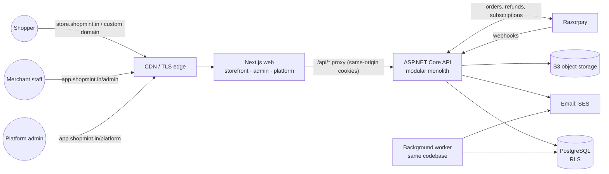

# System Architecture

## 1. Context



## 2. Modular monolith

One deployable API. It is organised by **module**, and each module owns its tables, endpoints and
services. Modules may call each other only through public interfaces in `Modules/<X>/Contracts` or
through domain events delivered via the outbox. Rules for direct database access across modules are
enforced by convention and code review now, and by an architecture test later.

| Module | Owns | MVP |
|---|---|---|
| Platform | Tenants, domains, plans, entitlements, platform users | ✓ |
| Identity | Users, memberships, roles and permissions, customers, sessions | ✓ |
| Catalog | Categories, products, options, variants, media | ✓ |
| Inventory | Locations, stock levels, reservations, movement ledger | ✓ |
| Storefront | Carts, wishlists, public read models | ✓ |
| Orders | Orders, lines, state machine, invoices, shipments, returns | ✓ |
| Payments | Gateway adapters, payment attempts, refunds, webhook inbox | ✓ |
| Billing | SaaS subscriptions and invoices (separate from Payments' merchant money) | ✓ |
| Marketing | Coupons, promotions | ✓ |
| Notifications | Email templates and delivery | ✓ |
| Reporting | Read models and aggregates | partial |
| Audit | Append-only audit log | ✓ |

Within a module the layers are: `Endpoints` (HTTP mapping only) → `Application` (use-case handlers,
validators) → `Domain` (entities, invariants, pure rules such as `GstCalculator`) → `Infrastructure`
(EF configurations, gateway clients).

## 3. Multi-tenancy and isolation

**Model:** shared database, shared schema. Every tenant-owned table has `tenant_id uuid not null`.

### 3.1 Tenant resolution

| Surface | How the tenant is resolved | Trust |
|---|---|---|
| Storefront (`/api/storefront/*`) | Request host → `tenant_domains.host` lookup (subdomain or verified custom domain). The web tier forwards the original host in `X-Forwarded-Host`, which the API accepts only from the configured proxy. | Host only; never body or query |
| Merchant admin (`/api/admin/*`) | `tid` claim in the authenticated session, **re-validated against an active membership on every request** (a cached membership lookup). Switching store issues a new session after a membership check. | Server session |
| Platform (`/api/platform/*`) | No tenant context; requires the `PlatformAdmin` role; uses a separate DbContext connection role (§3.3) | Server session |
| Background jobs | `tenant_id` stored on the outbox or job row; the runner opens a scope with `TenantContext` set from it | Database row |
| Webhooks | Razorpay order or payment ID → lookup of the owning tenant by our stored mapping (never from payload notes alone) | Signature + database |

### 3.2 Layer 1: application

- `ITenantContext` (scoped) holds the resolved tenant. Nothing in the request body can set it.
- EF Core global query filter on every `ITenantOwned` entity: `e.TenantId == tenantContext.TenantId`.
- `SaveChanges` interceptor stamps `TenantId` on inserts and **rejects** modifications to rows of another tenant.
- Composite foreign keys `(tenant_id, x_id)` → `x(tenant_id, id)` make cross-tenant references impossible at the schema level.

### 3.3 Layer 2: PostgreSQL row-level security

```sql
ALTER TABLE products ENABLE ROW LEVEL SECURITY;
ALTER TABLE products FORCE ROW LEVEL SECURITY;
CREATE POLICY tenant_isolation ON products
  USING (tenant_id = nullif(current_setting('app.tenant_id', true), '')::uuid)
  WITH CHECK (tenant_id = nullif(current_setting('app.tenant_id', true), '')::uuid);
```

- The API connects as `shopmint_app`, which is **not** the table owner and has no `BYPASSRLS`.
- A `DbConnectionInterceptor` runs `set_config('app.tenant_id', <tid or ''>, false)` **every time a connection is taken from the pool**, so a pooled connection never carries a previous request's tenant. With no tenant the setting is empty, which matches zero rows: the system fails closed.
- Platform operations use a separate `shopmint_platform` role (with `BYPASSRLS`) and a separate DbContext that is only registered for `/api/platform/*` endpoints.
- Migrations run as `shopmint_owner` from a one-off job, never from the app role.
- RLS is the backstop for bugs in layer 1 (a raw SQL query, a forgotten filter, `IgnoreQueryFilters`). It is covered by direct database tests.

## 4. Critical flows

### 4.1 Checkout and overselling prevention

1. `POST /api/storefront/checkout` with an `Idempotency-Key` header. A duplicate key returns the original response.
2. In one transaction: re-price the cart from the database (ignoring client prices), validate the coupon, then for each line run `UPDATE stock_levels SET reserved = reserved + :q WHERE variant_id = :v AND on_hand - reserved >= :q`. If zero rows are affected, the whole transaction rolls back with a `409 out_of_stock` problem that names the line.
3. Insert the order (`PendingPayment`) with line snapshots, the reservation rows (`expires_at = now() + 15m`) and an outbox message.
4. Create the Razorpay order (outside the transaction; retried; stored on the payment attempt).
5. Webhook `payment.captured` → verify HMAC → inbox de-duplication by event ID → transition to `Confirmed`, commit the reservation (`on_hand -= q, reserved -= q`), assign the invoice number from the tenant series, enqueue email.
6. A reaper job releases expired reservations and marks orders `Expired`. A late capture after expiry triggers an automatic refund.

### 4.2 Order state machine

```
PendingPayment ─► Confirmed ─► Packed ─► Shipped ─► Delivered ─► (ReturnRequested ─► Returned)
      │               │           │
      ▼               ▼           ▼
   Expired        Cancelled   Cancelled            (refunds are separate records: Pending → Processed/Failed)
```

Transitions are methods on the `Order` aggregate. Illegal transitions throw a domain exception, which the
API maps to `409 invalid_state_transition`. Concurrency control uses an `xmin` row-version token.

## 5. Cross-cutting

- **Errors:** RFC 9457 ProblemDetails with `type`, `title`, `status`, `traceId` and, for validation, `errors{field:[...]}`. Production never includes exception details.
- **Correlation:** the `X-Correlation-Id` header is accepted or generated, echoed back, and added to the log scope and the ProblemDetails `traceId`.
- **Idempotency:** an `idempotency_keys` table keyed by (tenant, key, route) stores a request hash and the response, for checkout, refunds and other POSTs with money effects.
- **Outbox:** domain events are written in the same transaction, and a background dispatcher delivers them at least once. Handlers are idempotent.
- **Caching:** storefront pages use Next.js ISR with tag revalidation (`tenant:{id}:product:{id}`), triggered by an API webhook to the web tier after catalogue changes.

## 6. Frontend architecture (`apps/web`)

```
app/
  (marketing)/            public SaaS site: landing, pricing, signup
  (auth)/login, signup    merchant auth
  admin/                  merchant dashboard (client-heavy, TanStack Query)
  platform/               platform console
  store/[host]/           storefront (RSC + cached fetches), reached via proxy.ts rewrite by host
components/ui/            design system primitives (owned, shadcn pattern)
components/<feature>/     feature components
lib/api/                  typed fetch client + zod schemas mirroring API contracts
```

`proxy.ts` (Next.js 16's name for middleware) maps an incoming host to a route group. Hosts not listed in
`APP_HOSTS` are rewritten to `/store/[host]/…`, so one deployment serves every storefront and custom domain.
Storefront pages use Partial Prerendering: a static shell, plus host-specific content streamed from
`"use cache"` server fetches. The admin is a static shell with client-side data (TanStack Query).

## 7. Design system

Tokens are CSS variables in `app/globals.css`, exposed to Tailwind via `@theme`:

- **Colour:** neutral slate scale for surfaces and text; one brand accent (`--brand`, tenant-overridable on the storefront, fixed ShopMint indigo in admin); semantic success, warning, danger and info. Tenant brand colours are validated for 4.5:1 contrast against white, and a foreground colour is auto-picked.
- **Type:** Inter (UI) with tabular numerals for money; scale 12/13/14/16/20/24/30/36.
- **Spacing:** 4 px grid. **Radius:** 6 (controls) and 10 (cards). **Elevation:** a border first, shadow only for overlays.
- **Components:** Button, Input, Textarea, Select, Checkbox, Label, Field (label + hint + error), Card, Badge, Table, Skeleton, EmptyState, PageHeader, Dialog, Toast, Tabs, Pagination, Stat.
- **States:** every data view implements loading (skeleton), empty (an explanation and a primary action), error (message and retry) and success.
